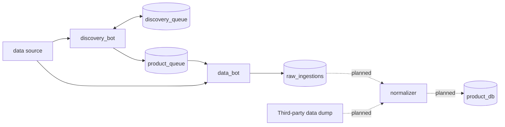

# product-db

A work-in-progress product database built by scraping online retailers and public data dumps. Sources are added manually, and Python bots using source-specific adapters find products on each source,
save their raw data to PostgreSQL, and a later step normalizes it into one product database.

Project started in 2025

## How it works



1. `discovery_bot` finds every product listing from a source and adds it to `product_queue` table.
2. `data_bot` takes due products from the queue, downloads each product's raw data and saves it to `raw_ingestions` table
   as JSON.

**Design decisions**

- **Bots coordinate only through the database.** Jobs are claimed with `FOR UPDATE SKIP LOCKED`, so any number of bot
  instances can run in parallel without a message broker.
- **Jobs are small.** A discovery job is one page of product listings or one api call, and a data job is one product. That way, a bot instance failing has little to no impact on the job queue.
- **Source-specific adapters.** Claiming jobs, rate limiting, retries and saving results work the
  same for every source. Only the adapters know a source. Adding a source means writing its two
  adapters, not changing the pipeline.
- **Rate limits** Kept in memory in each bot, with exponential backoff on failures, so that each bot instance could run on a different proxy with its own backoff status.
- **Raw data is stored unaltered.** Normalizing it is a separate step, so it can be rerun without scraping again.

## Tech stack

Python 3.12, PostgreSQL 17, psycopg 3 (with `psycopg_pool`), Docker Compose.

## Running it

> **Source adapters are not included in this repo.** Without one the bots start and wait for work. An adapter for a
> working source is available on request: put its folder in `adapters/` before starting.

Requires [Docker](https://docs.docker.com/get-docker/).

```sh
docker compose up --build
```

On start the discovery bot adds every source in `adapters/` to the database, and the bots start working.

```sh
docker compose down -v   # stop everything and delete the database
```

The database is on `localhost:5432` (user and password `postgres`, database `product_ingestions`).

## Database

| Table | Contents |
|---|---|
| `data_sources` | One row per source: rate limits, bot intervals, adapter names, status |
| `discovery_queue` | Job queue for discovery_bot |
| `product_queue` | Job queue for data_bot |
| `raw_ingestions` | Raw product JSON data |

## Adding a source

Add a folder to `adapters/` named after the domain (`example.com` → `example_com/`) with a `discovery.py` and a
`data.py` adapter and a `source.json` config.

## Status

- [x] Ingestions database
- [x] Discovery bot and data bot pipelines
- [ ] Reaper and circuit breaker (database workers)
- [ ] Multi-processing jobs per bot instance
- [ ] Third-party data dumps pipeline
- [ ] Normalize, deduplicate and merge to product_db database
- [ ] Image bot and price bot
- [ ] Search engine-type front-end for product_db

## Known limitations

- Each bot instance runs one job at a time. Multi-processing out of scope for now.
- No automated tests yet.
- Limited error handling.
- Without database workers, jobs in queue can get stuck in the "in-progress" state.

## Disclosures
To setup this public repo from a personal project I've used Claude Code's assistance to:
- Set up Docker Compose
- Clean up spelling and messy comments
- Draft the various README files across the project
- Move adapters from their corresponding bot folders to a single root folder and initialize them from there. For a public repo, this allows an easy .gitignore and easy setup after receiving the adapters afterwards for review. I am disclosing this because that part of the implementation does not represent what I could code on my own at this time, but I do understand how the code works and could explain it.